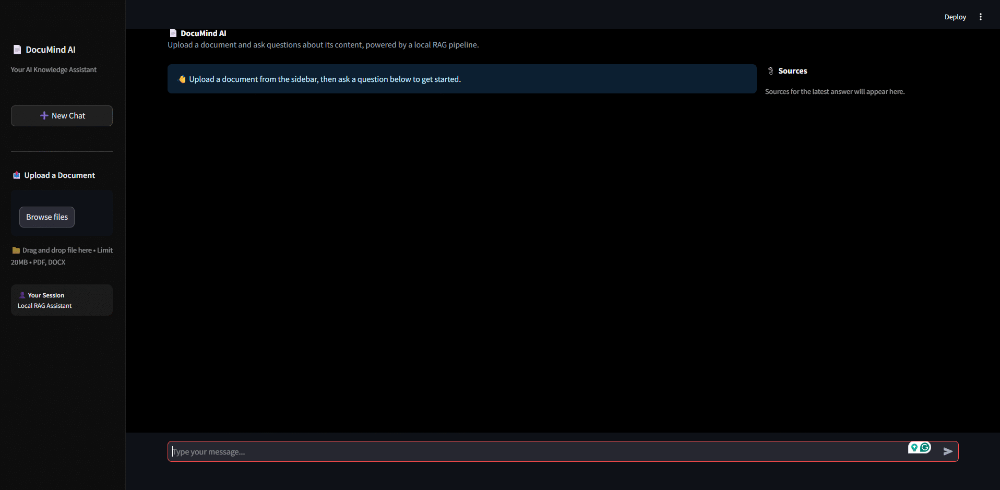

# DocuMind AI 📄



DocuMind AI lets you upload a PDF or Word file and ask questions about it. It answers from the document, shows which file the answer came from, and tells you plainly when the document doesn't contain the answer.

I started this project to learn how RAG works without hiding behind a framework. Version 1 was a plain pipeline: find similar chunks, send them to an LLM, show the answer. It worked, but it had blind spots. When the search pulled back the wrong chunks, the model either guessed or said "I don't know" while still showing a source next to it. Version 2 turns the pipeline into a small agent that checks its own work before it answers.

## What happens when you ask a question

1. **Plan.** The LLM picks a search tool: meaning-based search, exact keyword search (useful for IDs, phone numbers and emails), or a search limited to one file.
2. **Retrieve.** The chosen tool pulls the most relevant chunks from ChromaDB.
3. **Evaluate.** The LLM reads those chunks and decides whether they actually answer the question. If they don't, it writes a better search query and the agent tries again, up to 3 times.
4. **Draft.** The answer is written using only the retrieved chunks.
5. **Self-check.** One more pass compares the draft with the chunks. Unsupported claims get corrected, or the answer becomes "I don't have information about that in the uploaded document(s)."

When the answer is "no information", no source is shown. That exact bug is what pushed me to build version 2.

In the sidebar you can turn on **Show agent details**. Each answer then gets a small timeline: which tool was used, how many chunks came back, whether there was a retry, and how long each step took.

## A couple of examples

These come from a fictional company knowledge base I use for testing:

- *"Can I use Cash on Delivery for a BDT 20,000 order?"*
  No. The document says COD is only available for orders under BDT 15,000. The model has to compare two numbers here, which my early local models got wrong.
- *"What is the CTO's salary?"*
  The document names the CTO but never mentions a salary. The agent searches, rewrites the query, searches again, and then says it doesn't have that information. No source is shown.

## Tech stack

| Part | Tool |
|---|---|
| API | FastAPI |
| UI | Streamlit |
| Vector database | ChromaDB |
| Embeddings | Sentence Transformers (`all-MiniLM-L6-v2`) |
| LLM | Groq (cloud) or Ollama (local) |
| Document parsing | PyPDF, python-docx |
| Tests | pytest |

## Running it locally

You need Python 3.11+. For the cloud model you need a free Groq API key. For the fully local option you need [Ollama](https://ollama.com).

```bash
git clone https://github.com/hasan-murad1/docu-mind-ai.git
cd docu-mind-ai

python -m venv venv
venv\Scripts\activate

pip install -r requirements.txt
```

Copy the example env file and add your Groq key:

```bash
copy .env.example .env
```

Then start the backend and the frontend in two terminals:

```bash
# Terminal 1
uvicorn app.main:app --reload

# Terminal 2
streamlit run frontend/app.py
```

Open `http://localhost:8501`, upload a document and start asking.

### Groq or Ollama

The provider is set by `LLM_PROVIDER` in `app/core/rag_pipeline.py`:

- `"groq"`: faster and handles reasoning questions better. I've tested it with `openai/gpt-oss-20b` and `qwen/qwen3.8-27b`.
- `"ollama"`: runs completely on your machine. Run `ollama pull qwen3:4b` first.

On Groq's free tier you will sometimes see slower answers. Each question uses about 4 LLM calls, and when Groq says "slow down" the app waits the time Groq asks for and tries again instead of failing.

### Tests

```bash
python -m pytest -q
```

There are 210 tests. None of them call a real LLM. The agent tests use scripted fake responses, so they're fast and give the same result every run.

## API

`POST /upload` takes a PDF or DOCX file and stores its chunks.

`POST /ask` takes `{"question": "..."}` and returns:

```json
{
  "answer": "The CEO of NovaCart is Rafiq Ahmed.",
  "sources": ["NovaCart_Company_Knowledge_Base.pdf"],
  "trace": [
    {"step": "plan", "tool": "llm", "chunks_retrieved": 0, "best_distance": null, "retry": 0, "time_ms": 374.0, "llm_calls": 1}
  ]
}
```

The trace only ever contains those seven fields. Prompts and API keys never leave the server.

## Limits and safety

- Questions are capped at 500 characters. Each client gets 10 requests per minute, and the whole app has a daily cap of 200 LLM calls. Every agent step counts toward it.
- One question can use at most 8 LLM calls and 3 retries. Every loop in the code has a fixed limit.
- Uploads must be PDF or DOCX, up to 20 MB. Files are saved under a random name, not the name the user sent.
- Document text is wrapped in tags and marked as data, not instructions, so text inside a PDF can't easily take over the prompt.
- The planner, evaluator and self-check must reply with strict JSON. Anything that doesn't match is rejected, and the agent falls back to plain vector search. It's never worse than the old version.
- The agent's tools can only read. Even if a document managed to trick the model, there is nothing for it to delete or change.

## Project layout

```
docu-mind-ai/
├── app/
│   ├── core/
│   │   ├── agent.py               # the agent loop, budget and trace
│   │   ├── planner.py             # picks a search tool
│   │   ├── evaluator.py           # checks the chunks, rewrites the query
│   │   ├── self_check.py          # checks the draft answer
│   │   ├── vector_store.py        # ChromaDB + vector/keyword/file search
│   │   ├── document_processor.py  # text extraction and chunking
│   │   ├── rag_pipeline.py        # prompt building and LLM providers
│   │   └── usage_limiter.py       # rate limit and daily cap
│   └── main.py                    # FastAPI app
├── frontend/
│   ├── app.py                     # Streamlit UI
│   └── ui_helpers.py              # trace timeline and safe markdown
├── tests/
├── .env.example
└── requirements.txt
```

## Things I learned building this

**A distance threshold can't judge relevance on its own.** "Who won the 2018 World Cup?" matched one of my chunks at distance 1.84, under my 2.0 threshold, so version 1 showed a source for a question the document had nothing to do with. The evaluator step fixed it because it reads the text instead of trusting a number.

**Chunk size matters more than I expected.** With 300-word chunks the fact I needed was buried in surrounding text. 200 words with a 40-word overlap worked much better. Table rows still land around distance 2.0, so I couldn't make the threshold stricter without losing them.

**Small local models struggle with comparisons.** `llama3.2:1b` and `qwen3:4b` kept getting questions like the COD one wrong. A bigger model on Groq got them right, which is why the provider can be switched.

**Don't trust JSON from an LLM.** Models wrap it in code fences, add explanations, or invent keys. I parse loosely but validate strictly, and every failure has a safe fallback.

**Debug retrieval and generation separately.** Most of my "the model is dumb" moments turned out to be retrieval problems. A small script that prints chunk distances saved me a lot of time.

**Re-uploading a file used to create duplicate chunks.** Now the old chunks for that file are deleted before the new ones are stored.

## Known limitations

- It's slower than plain RAG and uses more of the API quota, about 4 LLM calls per question instead of 1.
- All uploaded documents share one database, so it isn't ready for many users at once.
- Rate limits are tracked per IP and kept in memory, so they reset when the server restarts. A real deployment would keep them in Redis.
- There's no live demo yet. That's the next thing I'm working on.

## Versions

- **v1.0**: plain RAG pipeline
- **v2.0**: agentic RAG with a planner, three search tools, an evaluate and retry loop, a self-check, and an agent trace in the UI

## License

This project is licensed under the [MIT License](LICENSE).