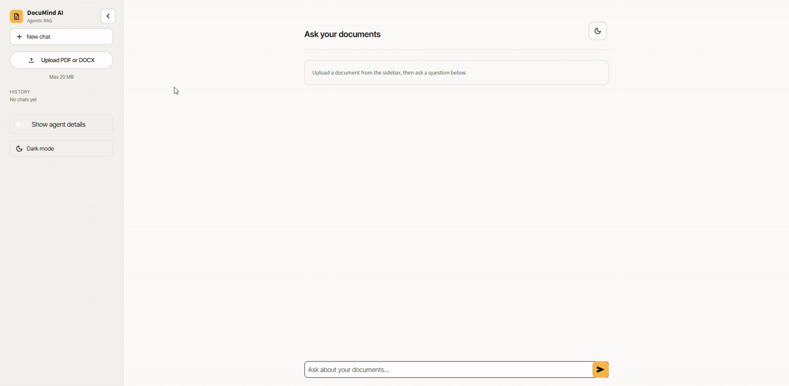

# DocuMind AI 📄

**Live demo:** [documind-hasan.streamlit.app](https://documind-hasan.streamlit.app/)



DocuMind AI lets you upload a PDF or Word file and ask questions about it. It answers from the document, shows which file the answer came from, and tells you plainly when the document doesn't contain the answer.

I started this project to learn how RAG works without hiding behind a framework. Version 1 was a plain pipeline: find similar chunks, send them to an LLM, show the answer. It worked, but it had blind spots. When the search pulled back the wrong chunks, the model either guessed or said "I don't know" while still showing a source next to it. Version 2 turns the pipeline into a small agent that checks its own work before it answers.

## Try it

Open the [live demo](https://documind-hasan.streamlit.app/). A sample document, a fictional travel company handbook, is already loaded, so you can click one of the sample questions right away. You can also upload your own PDF or DOCX.

To keep the free demo usable for everyone, each visitor gets 5 questions and 3 uploads per day. If the app has been idle for a while, Streamlit puts it to sleep. Click the wake-up button and give it a minute.

## What happens when you ask a question

1. **Plan.** The LLM picks a search tool: meaning-based search, exact keyword search (useful for IDs, phone numbers and emails), or a search limited to one file.
2. **Retrieve.** The chosen tool pulls the most relevant chunks from ChromaDB.
3. **Evaluate.** The LLM reads those chunks and decides whether they actually answer the question. If they don't, it writes a better search query and the agent tries again, up to 3 times.
4. **Draft.** The answer is written using only the retrieved chunks.
5. **Self-check.** One more pass compares the draft with the chunks. Unsupported claims get corrected, or the answer becomes "I don't have information about that in the uploaded document(s)."

When the answer is "no information", no source is shown. That exact bug is what pushed me to build version 2.

In the sidebar you can turn on **Show agent details**. Each answer then gets a small timeline: which tool was used, how many chunks came back, whether there was a retry, and how long each step took.

The UI has a light and a dark theme, a sidebar you can hide, and a history of your chats. The history only lives in your browser session, so nothing is saved on the server.

## A couple of examples

These come from a fictional company knowledge base I use for testing:

- *"Can I use Cash on Delivery for a BDT 20,000 order?"*
  No. The document says COD is only available for orders under BDT 15,000. The model has to compare two numbers here, which my early local models got wrong.
- *"What is the CTO's salary?"*
  The document names the CTO but never mentions a salary. The agent searches, rewrites the query, searches again, and then says it doesn't have that information. No source is shown.

## Tech stack

| Part | Tool |
|---|---|
| UI | Streamlit |
| API | FastAPI |
| Vector database | ChromaDB |
| Embeddings | `all-MiniLM-L6-v2` (ONNX build that ships with ChromaDB, no PyTorch needed) |
| LLM | Groq (cloud) or Ollama (local) |
| Document parsing | PyPDF, python-docx |
| Tests | pytest |
| Hosting | Streamlit Community Cloud |

## Running it locally

You need Python 3.11+. For the cloud model you need a free Groq API key. For the fully local option you need [Ollama](https://ollama.com).

```bash
git clone https://github.com/hasan-murad1/docu-mind-ai.git
cd docu-mind-ai

python -m venv venv
venv\Scripts\activate

pip install -r requirements.txt
```

Copy the example env file and add your Groq key:

```bash
copy .env.example .env
```

Then start the app:

```bash
streamlit run frontend/app.py
```

Open `http://localhost:8501`. The sample document loads on its own, or you can upload your own file.

The Streamlit app calls the agent directly, so you don't need a separate backend. If you want the REST API as well, run it in a second terminal:

```bash
uvicorn app.main:app --reload
```

### Groq or Ollama

The provider is read from the `LLM_PROVIDER` environment variable (default `groq`), and the Groq model from `GROQ_MODEL`:

- `groq`: faster and handles reasoning questions better. I've tested it with `openai/gpt-oss-20b` and `qwen/qwen3.8-27b`.
- `ollama`: runs completely on your machine. Run `ollama pull qwen3:4b` first.

On Groq's free tier you will sometimes see slower answers. Each question uses about 4 LLM calls, and when Groq says "slow down" the app waits the time Groq asks for and tries again instead of failing.

If no Groq key is set, the app still opens and tells you that the AI provider isn't set up yet, instead of crashing.

### Tests

```bash
python -m pytest -q tests
```

There are 355 tests. None of them call a real LLM. The agent tests use scripted fake responses, so they're fast and give the same result every run.

## API

`POST /upload` takes a PDF or DOCX file and stores its chunks.

`POST /ask` takes `{"question": "..."}` and returns:

```json
{
  "answer": "The CEO of NovaCart is Rafiq Ahmed.",
  "sources": ["NovaCart_Company_Knowledge_Base.pdf"],
  "trace": [
    {"step": "plan", "tool": "llm", "chunks_retrieved": 0, "best_distance": null, "retry": 0, "time_ms": 374.0, "llm_calls": 1}
  ]
}
```

The trace only ever contains those seven fields. Prompts and API keys never leave the server.

## Limits and safety

Putting an LLM app on the public internet means anyone can upload anything and ask anything, so most of the work in v2.2 went here.

**Usage limits**

- Each visitor gets 5 questions and 3 uploads per day. A failed question or upload is refunded.
- The whole app has a daily cap of 200 LLM calls. Every agent step counts toward it.
- One question can use at most 8 LLM calls and 3 retries. Every loop in the code has a fixed limit.
- Questions are capped at 500 characters.

**Uploads**

- Only PDF and DOCX, up to 5 MB and 30 pages. DOCX files are capped at 20,000 words.
- The file type is checked from the file's actual bytes, not its extension. A renamed `.exe` is rejected.
- DOCX files are zip archives, so their uncompressed size is checked before opening them. This blocks "zip bombs".
- File names are cleaned before use, and the uploaded file is deleted as soon as its text is extracted.

**Prompt injection**

- Document text is wrapped in tags and marked as data, not instructions, so text inside a PDF can't easily take over the prompt.
- The planner, evaluator and self-check must reply with strict JSON. Anything that doesn't match is rejected, and the agent falls back to plain vector search. It's never worse than the old version.
- The agent's tools can only read. Even if a document managed to trick the model, there is nothing for it to delete or change.

## Privacy

- Every visitor gets their own private space in the database. Nobody else can search or see the files you upload.
- Your files are deleted automatically after 2 hours. You can also delete them right away with **Delete my files now** in the sidebar.
- The original file isn't kept. Only the extracted text chunks are stored, and only until they expire.
- Please don't upload anything sensitive to the public demo anyway. It's a portfolio project, not a secure document vault.

## Project layout

```
docu-mind-ai/
├── app/
│   ├── core/
│   │   ├── agent.py               # the agent loop, budget and trace
│   │   ├── planner.py             # picks a search tool
│   │   ├── evaluator.py           # checks the chunks, rewrites the query
│   │   ├── self_check.py          # checks the draft answer
│   │   ├── vector_store.py        # ChromaDB + vector/keyword/file search
│   │   ├── document_processor.py  # text extraction and chunking
│   │   ├── rag_pipeline.py        # prompt building and LLM providers
│   │   ├── usage_limiter.py       # daily cap and per-visitor limits
│   │   ├── upload_security.py     # file type, size and page checks
│   │   ├── sessions.py            # private per-visitor collections with expiry
│   │   └── service.py             # shared logic used by both the UI and the API
│   └── main.py                    # FastAPI app
├── frontend/
│   ├── app.py                     # Streamlit UI
│   ├── ui_helpers.py              # trace timeline and safe markdown
│   └── session_helpers.py         # sample questions and visitor helpers
├── demo_docs/                     # sample document loaded at startup
├── tests/
├── .env.example
└── requirements.txt
```

## Things I learned building this

**A distance threshold can't judge relevance on its own.** "Who won the 2018 World Cup?" matched one of my chunks at distance 1.84, under my 2.0 threshold, so version 1 showed a source for a question the document had nothing to do with. The evaluator step fixed it because it reads the text instead of trusting a number.

**Chunk size matters more than I expected.** With 300-word chunks the fact I needed was buried in surrounding text. 200 words with a 40-word overlap worked much better. Table rows still land around distance 2.0, so I couldn't make the threshold stricter without losing them.

**Small local models struggle with comparisons.** `llama3.2:1b` and `qwen3:4b` kept getting questions like the COD one wrong. A bigger model on Groq got them right, which is why the provider can be switched.

**Don't trust JSON from an LLM.** Models wrap it in code fences, add explanations, or invent keys. I parse loosely but validate strictly, and every failure has a safe fallback.

**Debug retrieval and generation separately.** Most of my "the model is dumb" moments turned out to be retrieval problems. A small script that prints chunk distances saved me a lot of time.

**Re-uploading a file used to create duplicate chunks.** Now the old chunks for that file are deleted before the new ones are stored.

**Going public changes the problem.** Locally, one shared database was fine. Online, one visitor's upload would show up in another visitor's answers. Giving each visitor their own collection with an expiry time fixed that, and it also made cleanup simple.

## Known limitations

- It's slower than plain RAG and uses more of the API quota, about 4 LLM calls per question instead of 1.
- Usage counters are kept in memory, so they reset when the server restarts. On the hosted demo a visitor's daily quota can also reset after a page refresh. The global cap of 200 LLM calls per day still holds. A real deployment would keep these counters in Redis.
- The free hosting tier has limited memory and goes to sleep when idle, so the first load can be slow.

## Versions

- **v1.0**: plain RAG pipeline
- **v2.0**: agentic RAG with a planner, three search tools, an evaluate and retry loop, a self-check, and an agent trace in the UI
- **v2.1**: redesigned UI with light and dark themes, a collapsible sidebar, session chat history and a cleaner agent timeline
- **v2.1.1**: answer quality fixes: no visible reasoning in answers, and sources from unrelated files are no longer shown
- **v2.2**: public live demo with per-visitor limits, upload security, private per-visitor storage with auto-delete, and a preloaded sample document

## License

This project is licensed under the [MIT License](LICENSE).